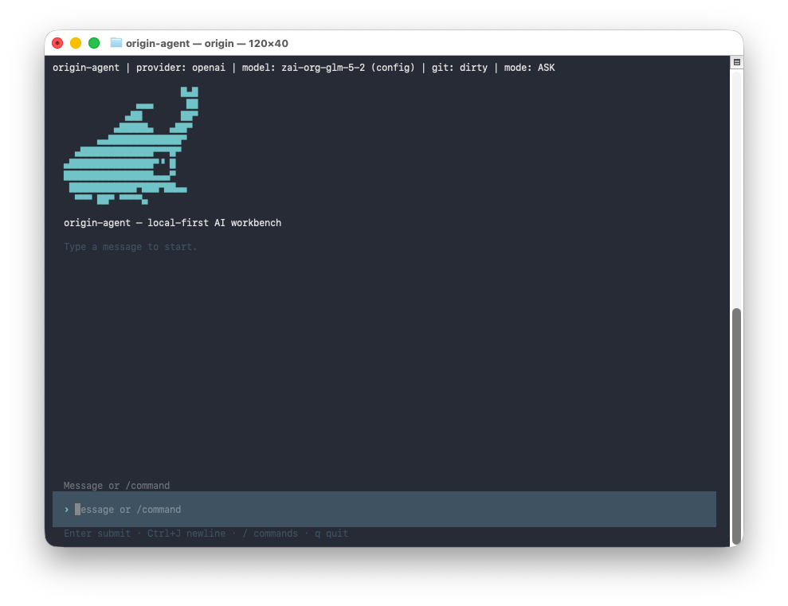
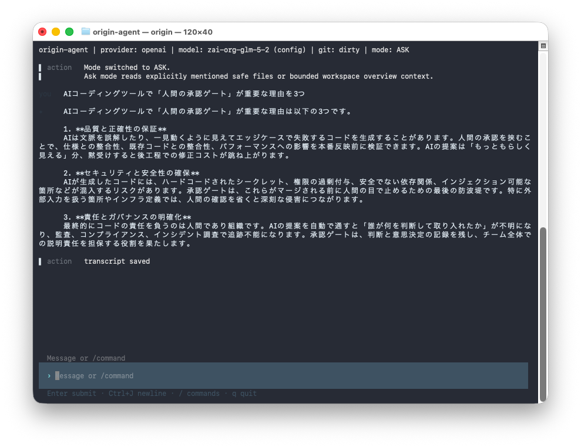
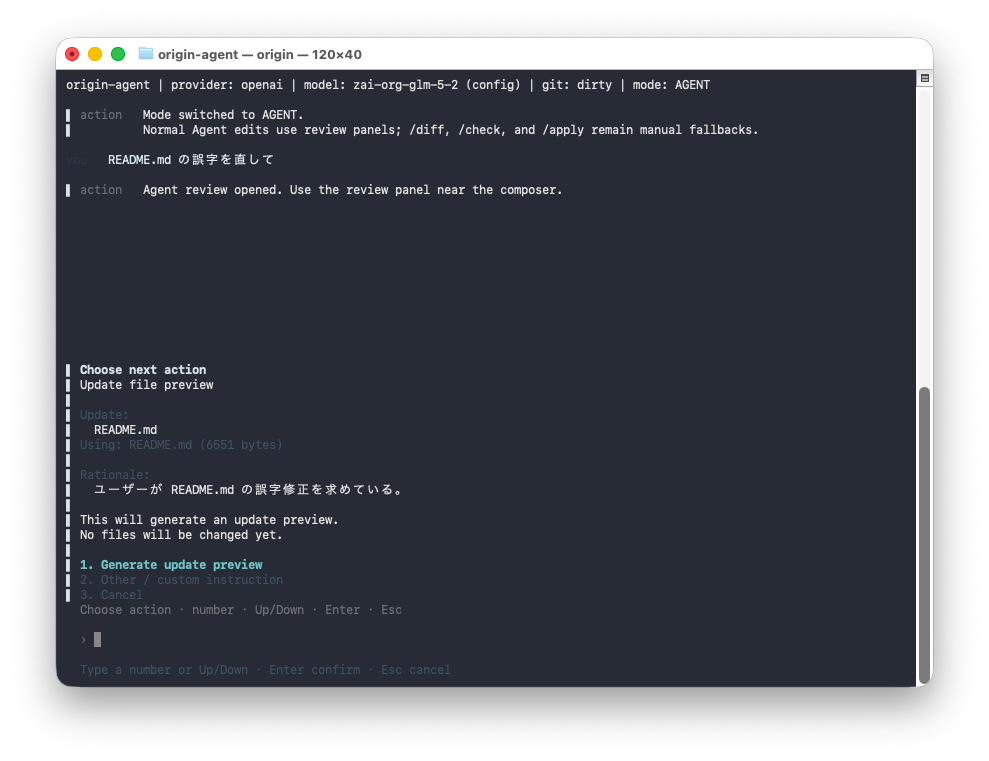
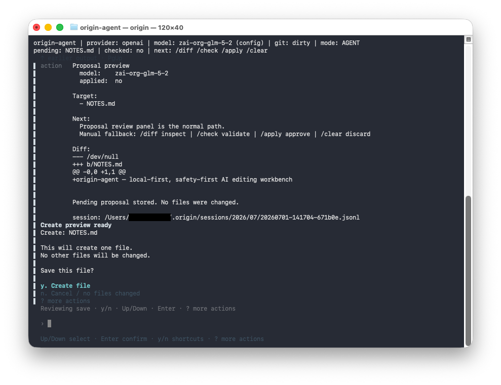

**English** | [日本語](README.md)

# origin-agent

**A safety-first, local-first AI editing workbench for your terminal.**

Chat with a local or API LLM, let it propose file edits as diffs, and apply nothing
without your explicit approval. `origin-agent` (command: `origin`) is a Rust CLI + TUI
that pairs aider-style model/provider freedom with a Codex / Gemini-CLI–like terminal
UX — kept deliberately small, controllable, and human-approved.



> **Latest release: v1.4.0** · full history in [`CHANGELOG.md`](CHANGELOG.md).
> Not a replacement for Claude Code or Codex — those stay the right tools for broad,
> fast, multi-file implementation work. `origin-agent` is the smaller, controllable
> alternative for file-scoped, human-approved edits with the model and provider *you* choose.

## Why I built this

I wanted the model freedom of aider, the terminal-native feel of Codex / Gemini CLI,
and a safety model I could fully trust — in one small tool. So `origin-agent` treats
local models (LM Studio) and OpenAI-compatible APIs (OpenAI, custom) as first-class,
and makes **every file write pass an explicit human approval gate**.

The interesting engineering is in keeping that promise: diffs are constructed and
`git apply --check`ed locally instead of trusting free-form model output, secrets
never reach transcripts, and the whole edit loop stays auditable. It is built to be
read as much as used — 6 focused crates, `unsafe` forbidden, and a 500+ test safety net.

## Highlights

- **Local-first, provider-flexible** — LM Studio, OpenAI, and any OpenAI-compatible
  endpoint. Switch model/provider per session with `/models`; nothing is hard-wired to
  one vendor.
- **Safety-first by default** — every create/update/write passes an explicit `y / n`
  human gate. No auto-apply, ever. Out-of-scope, broken, delete, and rename diffs are rejected.
- **Explicit-scope edits** — you name the files; the model returns a unified diff;
  origin builds and validates it locally and applies it only after you approve a
  `git apply --check`–passed patch.
- **A real TUI workbench** — Ask / Agent modes, a left-rail visual grammar, an attached
  slash-command palette, Japanese / full-width-aware input, and a block-art startup landing.
- **Explicit context, never implicit** — `ORIGIN.md` (workspace instructions),
  `~/.origin/memory.md` (user-owned memory that origin reads but never writes), and
  `/resume` for read-only background from a past session. All bounded, with
  metadata-only transcripts.
- **Built in Rust to be read** — separated provider / config / protocol / session /
  safety crates, `unsafe_code = "forbid"`, and 500+ tests.

## Demo

**Ask mode** — read-only chat that can pull in explicitly named files as context:



**Agent review** — choose an action (generate preview / adjust / cancel) *before*
anything is generated, separating plan selection from write approval:



**Save approval** — the `y / n` permission gate that guards every actual write:



> Screenshots live in [`docs/assets/`](docs/assets/).

## How the safety model works

1. **Read** — origin reads only the files you explicitly name (or a bounded, opt-in workspace overview).
2. **Propose** — the model returns a unified diff; origin constructs and validates it locally
   instead of trusting free-form output.
3. **Review** — you see the target and the diff in a dedicated review panel.
4. **Approve** — `y` writes through `git apply --check`; Enter / `n` / anything else rejects.
   Nothing on disk changes without this step.

## Quick start

Install locally:

```sh
cargo install --path crates/origin-cli
```

Run:

```sh
origin            # TUI workbench
origin --help     # command list
origin status     # provider / model / git state
```

Single-shot chat:

```sh
origin chat "hello"
```

To use LM Studio (the default provider), start its local server
(`http://localhost:1234/v1`) and load a model first. For the full command set, OpenAI /
config / sessions, and complete safety behavior, see the
**[full usage reference](docs/spec/usage-reference.md)**.

## Architecture

| Crate | Responsibility |
|---|---|
| `origin-cli` | The `origin` binary — CLI commands, the TUI workbench (chat, Ask/Agent, edit loop), and the legacy interactive shell |
| `origin-provider` | OpenAI-compatible provider abstraction + registry (LM Studio, OpenAI, custom endpoints) |
| `origin-config` | `~/.origin/config.toml` loading, built-in presets, and CLI → env → config → default precedence |
| `origin-protocol` | Shared chat / model / patch / session data types |
| `origin-session` | JSONL transcript logging, resume context, and secret redaction |
| `origin-tools` | The safety toolbox — file reads, diff extraction, patch validation, `git apply` checks, and the approval gate |

## Scope & status

- **It does**: chat with local/API models, per-session model/provider switching,
  Ask / Agent modes, and a single-file propose → review → approve → apply loop.
- **It intentionally does not**: auto-apply, multi-file natural-language edits, config
  auto-writing, provider auto-routing, MCP, or advanced resume.
- Full behavior is in the [usage reference](docs/spec/usage-reference.md); release history is
  in [`CHANGELOG.md`](CHANGELOG.md).

## Development

GitHub Actions runs Rust CI (fmt / check / test) on push and PR (it never calls
localhost, OpenAI, or anything needing `OPENAI_API_KEY`).

```sh
cargo check --workspace
cargo test --workspace
cargo run -p origin-cli -- --help
```

## Usage scope

© 2026 mokubo1228-hub. Public temporarily for portfolio review only. No license is granted for reuse, copying, or modification (all rights reserved).
