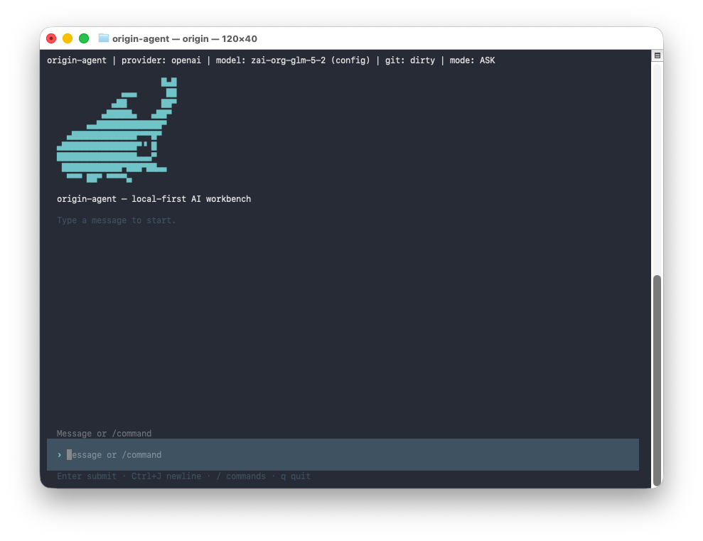
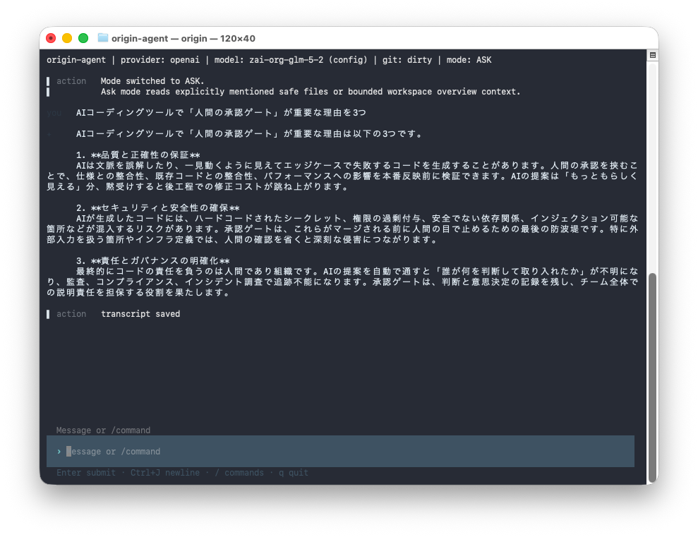
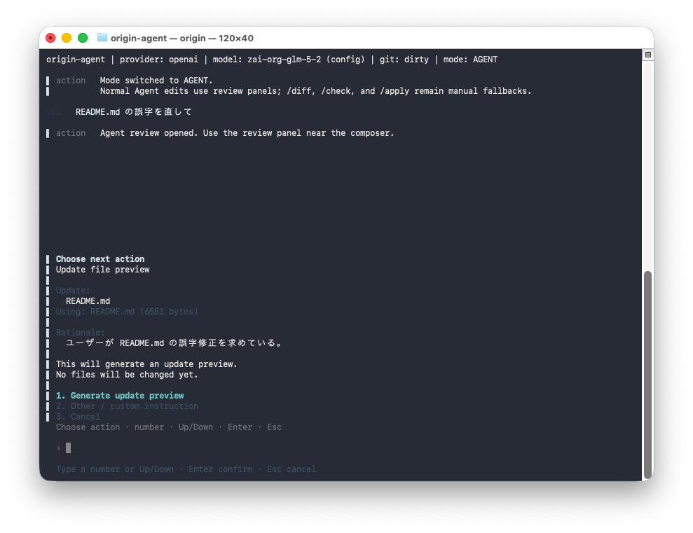
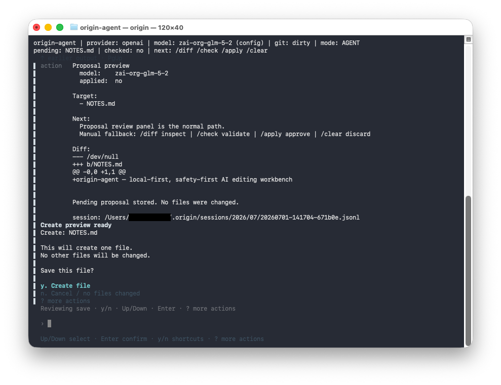

[English](README.en.md) | **日本語**

# origin-agent

**ターミナルで動く、安全第一・ローカル第一の AI 編集ワークベンチ。**

ローカル / API の LLM とチャットし、ファイル編集を diff として提案させ、あなたの
明示的な承認なしには何も書き込まない。`origin-agent`(コマンド: `origin`)は、
aider 的なモデル/プロバイダの自由度と、Codex / Gemini CLI のようなターミナル UX を、
あえて小さく・制御可能で・人間承認を前提にまとめた Rust 製 CLI + TUI。



> **最新リリース: v1.4.0** · 履歴は [`CHANGELOG.md`](CHANGELOG.md)。
> Claude Code / Codex の置き換えではない — 広範・高速・多ファイルの実装はそちらが適任。
> `origin-agent` は、自分で選んだモデルとプロバイダで「ファイル単位・人間承認つき」に
> 編集するための、小さく制御可能な選択肢。

## なぜ作ったか

aider のモデル自由度、Codex / Gemini CLI のターミナルネイティブな手触り、そして
自分が完全に信頼できる安全モデル — それを1つの小さな道具に収めたかった。だから
`origin-agent` は、ローカルモデル(LM Studio)と OpenAI 互換 API(OpenAI / 任意)を
第一級に扱い、**すべてのファイル書き込みを明示的な人間承認ゲートに通す**。

面白いのはその約束を守るための工学:diff はモデルの自由出力を信用せず**ローカルで
構築・検証し `git apply --check` を通す**、秘密情報は transcript に残さない、編集
ループ全体が監査可能。使うためだけでなく**読まれること**も意識して作っている —
6つの小さな crate、`unsafe` 禁止、500+ のテスト。

## 特徴

- **ローカル第一・プロバイダ自由** — LM Studio / OpenAI / 任意の OpenAI 互換
  エンドポイント。`/models` でセッションごとにモデル・プロバイダを切替。特定
  ベンダーに固定しない。
- **既定で安全第一** — create / update / write はすべて明示的な `y / n` 人間
  ゲートを通る。自動適用は一切なし。範囲外・壊れた・削除・リネームの diff は拒否。
- **明示スコープ編集** — 対象ファイルを指定 → モデルが unified diff を返す →
  origin がローカルで構築・検証 → `git apply --check` を通った patch をあなたが
  承認して初めて適用。
- **本物の TUI ワークベンチ** — Ask / Agent モード、左 rail のビジュアル文法、
  追従するスラッシュコマンドパレット、日本語/全角対応の入力、ブロックアートの
  起動画面。
- **読まれる前提の Rust** — provider / config / protocol / session / safety を分離
  した crate 構成、`unsafe_code = "forbid"`、500+ テスト。

## デモ

**Ask モード** — 明示的に指定したファイルを文脈に取り込める read-only チャット:



**Agent レビュー** — 何かを生成する *前* に「プレビュー生成 / 調整 / キャンセル」を
選ぶ。プラン選択と書き込み承認を分離:



**保存承認** — 実際の書き込みすべてを守る `y / n` パーミッションゲート:



> 画像は [`docs/assets/`](docs/assets/) に格納。

## 安全モデルの仕組み

1. **読む** — 明示的に指定したファイルのみ読む(または opt-in の限定的な
   ワークスペース概観)。
2. **提案** — モデルが unified diff を返す。origin は自由出力を信用せずローカルで
   構築・検証。
3. **レビュー** — 対象と diff を専用パネルで確認。
4. **承認** — `y` で `git apply --check` を通して書き込み。Enter / `n` / その他は
   拒否。このステップなしにディスクは変わらない。

## クイックスタート

ローカルにインストール:

```sh
cargo install --path crates/origin-cli
```

起動:

```sh
origin            # TUI ワークベンチ
origin --help     # コマンド一覧
origin status     # プロバイダ / モデル / git 状態
```

単発チャット:

```sh
origin chat "hello"
```

LM Studio を既定プロバイダとして使う場合は、ローカルサーバ
(`http://localhost:1234/v1`)を起動してモデルを読み込んでおく。全コマンド・
OpenAI / 設定ファイル / セッション・安全挙動の網羅は
**[利用リファレンス(完全版)](docs/spec/usage-reference.md)** を参照。

## アーキテクチャ

| crate | 責務 |
|---|---|
| `origin-cli` | `origin` バイナリ — CLI コマンド、TUI ワークベンチ(チャット / Ask・Agent / 編集ループ)、旧 interactive shell |
| `origin-provider` | OpenAI 互換プロバイダの抽象 + レジストリ(LM Studio / OpenAI / 任意エンドポイント) |
| `origin-config` | `~/.origin/config.toml` の読込・組込プリセット・CLI → env → config → 既定 の優先順位 |
| `origin-protocol` | 共有の chat / model / patch / session データ型 |
| `origin-session` | JSONL transcript ログ・resume コンテキスト・秘密情報の redaction |
| `origin-tools` | 安全ツールボックス — ファイル読込・diff 抽出・patch 検証・`git apply` チェック・承認ゲート |

## スコープと現状

- **できること**:ローカル/API モデルとのチャット、セッション内のモデル/プロバイダ
  切替、Ask / Agent モード、単一ファイルの提案 → レビュー → 承認 → 適用。
- **やらないこと(意図的)**:自動適用、多ファイルの自然言語編集、config 自動書込、
  プロバイダ自動ルーティング、MCP、高度な resume。
- 全挙動の網羅は [利用リファレンス](docs/spec/usage-reference.md)、リリース履歴は
  [`CHANGELOG.md`](CHANGELOG.md)。

## 開発

GitHub Actions が push / PR ごとに Rust CI(fmt / check / test)を実行
(localhost / OpenAI / `OPENAI_API_KEY` は呼ばない)。

```sh
cargo check --workspace
cargo test --workspace
cargo run -p origin-cli -- --help
```

## 公開範囲

© 2026 mokubo1228-hub. ポートフォリオ閲覧用に一時公開しています。再利用・複製・改変の許諾はありません(All rights reserved)。
